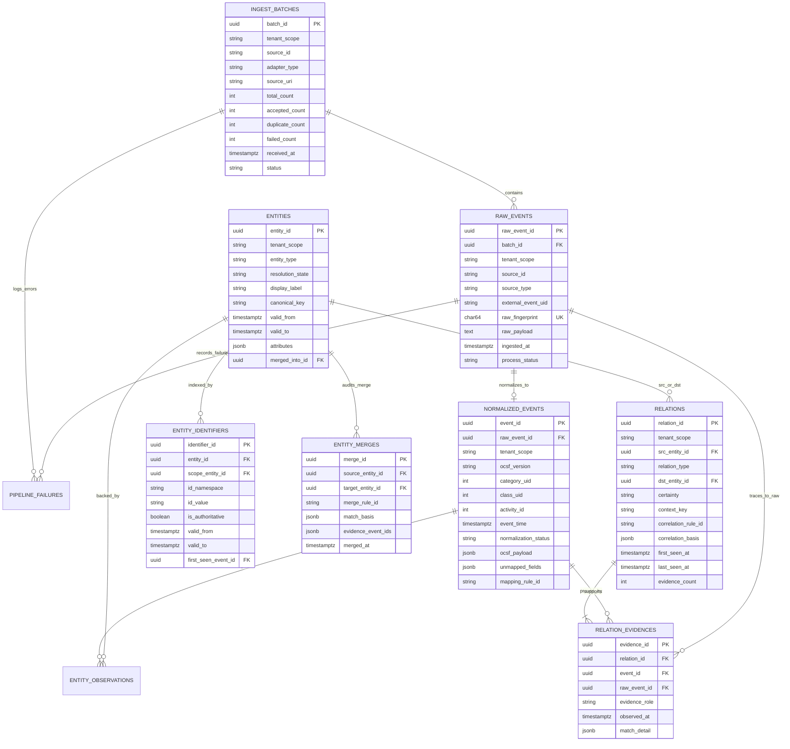

# ProvLoom（APT 数据处理组件）MVP 工程骨架设计

**对应 PRD 版本：** v0.1（MVP）  
**设计版本：** v0.2（新增 Web 调试与查看控制台设计、标准公开安全测试数据集方案）  
**设计目标：** 面向 M1 里程碑完成工程目录规划、前后端与存储技术选型论证、核心数据模型、模块接口契约、Web 调试台规划与测试数据方案，暂不包含具体业务实现代码。

---

## 1. 架构概览与设计约束对齐

本组件定位为 **“面向 APT 调查的安全事实与关系数据服务”**，并配套一个 **“面向研发调试与安全事实核验的 Web 可视化控制台”**。系统采用 **“不可变原始日志（Immutable Raw Log） + 可重放确定性流水线（Deterministic Pipeline） + 证据驱动属性图投影（Evidence-Backed Graph） + 统一查询与调试服务”** 架构。

### 1.1 核心原则的工程落地映射

| PRD 核心原则 | 工程设计保障机制 |
| :--- | :--- |
| **优先复用成熟标准** | 标准化层严格采用 **OCSF v1.3.0** 事件与对象字典，保留 `metadata.version` 与 `unmapped` 扩展槽位。 |
| **确定性程序处理** | 解析、映射、实体归一与关系提取全部基于纯函数、显式规则版本（`rule_id` + `rule_version`）和严格时间窗口，无黑盒推断。 |
| **不把推断写成事实** | 实体区分 `RESOLVED` / `SCOPED_TEMPORAL` / `PROVISIONAL` 状态；关系强制区分 `DETERMINISTIC`（确定性）与 `CANDIDATE`（候选），Web 图谱上分别以实线与虚线高亮区分。 |
| **原始数据不丢、结果可重建** | `raw_events` 表仅追加（Append-Only），不支持的事件回退为 OCSF Base/Passthrough 记录留存，失败事件进入 `pipeline_failures`；支持通过 CLI 或 Web 控制台触发重放与删图重建。 |
| **与 Agent 解耦** | 核心产物为领域 `QueryService` 与独立 REST/JSON 查询 API；Web 控制台复用同一套查询 API（Dogfooding）并调用独立的运维调试接口（`/api/v1/ops/*`）；后续 MCP Server 仅作为 API 之上的薄适配层。 |

### 1.2 全链路数据流与前后端分层边界

```mermaid
flowchart LR
    subgraph Sources["异构数据源与标准测试集"]
        S1["JSON / JSONL / CSV"]
        S2["Sysmon / 认证日志"]
        S3["Zeek / 防火墙流量"]
        S4["资产清单"]
    end

    subgraph Pipeline["确定性数据处理流水线 (Write Path)"]
        ING["1. 数据接入层 (Ingestion)"]
        PAR["2. 日志解析层 (Parsing)"]
        NRM["3. OCSF 标准化层 (Normalization)"]
        ENT["4. 实体识别与归一 (Entity Resolution)"]
        REL["5. 关系提取与跨源关联 (Graph Builder)"]
    end

    subgraph Storage["逻辑三层持久化 (PostgreSQL 16+)"]
        DB_RAW[("原始事件与异常库 (raw_events / failures)")]
        DB_OCSF[("标准化事件库 (normalized_events)")]
        DB_GRAPH[("实体与证据关系库 (entities / relations / evidences)")]
    end

    subgraph Serving["API 服务层 (FastAPI)"]
        QRY["QueryService (核心只读查询)"]
        OPS["OpsDebugService (导入 / 重试 / 重放 / 指标)"]
        API_CORE["核心查询 API (/api/v1/*)"]
        API_OPS["调试管理 API (/api/v1/ops/*)"]
    end

    subgraph Consumers["消费端"]
        WEB["Web 查看与调试控制台 (React + Cytoscape.js)"]
        MCP["(后续扩展) MCP Server / Investigation Agent"]
    end

    Sources --> ING
    ING -->|"SHA-256 幂等去重"| DB_RAW
    DB_RAW -->|"实时流转或重放重建"| PAR
    PAR --> NRM
    NRM -->|"含 unmapped 与兜底事件"| DB_OCSF
    DB_OCSF --> ENT
    ENT --> REL
    ENT --> DB_GRAPH
    REL -->|"绑定 Event/Raw 证据链"| DB_GRAPH

    DB_RAW -.-> QRY
    DB_OCSF -.-> QRY
    DB_GRAPH -.-> QRY
    DB_RAW -.-> OPS
    OPS -.->|"触发导入 / 重试 / 重放"| ING

    QRY --> API_CORE
    OPS --> API_OPS
    API_CORE --> WEB
    API_OPS --> WEB
    API_CORE -.-> MCP
```



---

## 2. 技术选型与评估依据

### 2.1 后端开发语言与核心框架：**Python 3.12+（推荐 MVP 首选）**

| 维度 | Python 3.12+ (`uv` + `FastAPI` + `Pydantic v2` + `SQLAlchemy 2.0`) | Go 1.23+ (`chi/gin` + `sqlx/pgx`) | 选型结论与演进策略 |
| :--- | :--- | :--- | :--- |
| **OCSF 生态成熟度** | 拥有成熟的 `py-ocsf-models` / Pydantic JSON Schema 代码生成生态，Pydantic v2（Rust 内核）兼具强类型校验与动态 `unmapped` 字典保留能力。 | 社区 OCSF Struct 库较少，处理海量可选嵌套字段与动态 `unmapped` 扩展时样板代码极重。 | **MVP 选定 Python 3.12+**。通过 `mypy --strict` + `Pydantic v2 (frozen=True)` 保证静态与运行期双重类型安全。 |
| **异构日志与映射迭代** | 原生适合快速编写 Sysmon/Zeek/CSV 解析器及声明式 YAML 字段映射（M2–M5 核心工作量）。 | 字段映射与动态结构转换开发周期较长。 | 优先保障 M1–M7 语义正确性与规则快速演进。 |
| **前后端契约联动** | `FastAPI` 自动产出精确的 OpenAPI 3.1 Schema，前端可一键生成 TypeScript 类型定义，零手工对齐成本。 | 需额外引入代码生成或手写 OpenAPI 注解。 | 显著提升后端 API 与 Web 调试台联调效率。 |
| **吞吐性能与演进** | 单进程配合 `orjson` + PG 批量 `INSERT ... ON CONFLICT` 可达 $5\times 10^3 \sim 2\times 10^4$ EPS。 | 高并发流式接入（> $5\times 10^4$ EPS）协程开销更优。 | 存储 Schema 与 REST API 语言无关；未来高吞吐流式接入层可独立扩展。 |

### 2.2 物理存储方案深度评估（对应 PRD 3.6）

针对 **PostgreSQL 关系模型**、**PostgreSQL + 图查询扩展（Apache AGE）** 与 **Neo4j 等专用图数据库** 的四维评估：

| 评估维度 | 方案 A：PostgreSQL 16+ 纯关系 + 邻接表 + `WITH RECURSIVE`（**MVP 推荐**） | 方案 B：PostgreSQL + Apache AGE 图扩展 | 方案 C：专用图库（Neo4j） + 关系/列存事件库（双库架构） |
| :--- | :--- | :--- | :--- |
| **目标数据规模适配** | 单机结合按时间分区可平稳支撑 $10^7 \sim 10^8$ 级事件、$10^6 \sim 10^7$ 级实体与边，覆盖 MVP 及调查场景。 | 同 PG 单机规模，但 `agtype` 索引与关系列混合过滤调优复杂。 | 适合 $10^8+$ 活跃边规模下的全图无约束深层遍历。 |
| **APT 图查询特征匹配度** | APT 调查与前端画布展开本质是 **“种子实体 + 时间窗 + 关系类型 + 确定性过滤 + 有限深度（1–6 跳）”** 的受限遍历。PG 14+ 原生 `WITH RECURSIVE ... SEARCH BREADTH FIRST ... CYCLE` 配合复合索引可在毫秒级完成并自动防环。 | 支持 OpenCypher，但在每跳同时做租户权限裁剪、时间窗过滤与证据表关联时，执行计划不如原生关系表透明可控。 | 无索引邻接在超深路径占优；但遇到安全场景的高连接度超级节点（DNS 服务器、域控、`svchost`）仍需依赖时间窗与边属性剪枝。 |
| **可追溯性与事务一致性** | **核心优势**：`raw_events`、`normalized_events`、`entities`、`relations`、`relation_evidences` 同处单一 ACID 事务内，幂等去重与删图重建**零双写不一致风险**。 | 同库事务，但关系表与 AGE 图空间跨层 Join 成本较高。 | **最大痛点**：Neo4j 不适合存海量原始日志与宽 JSON OCSF 事件，必须双库双写；失败重试与图重建需维护分布式一致性。 |
| **运维与测试成本** | **最低**：单一标准 PostgreSQL 实例，本地 Docker 与云托管 100% 兼容，SQL 可直接审计调试。 | 多数托管 RDS 不内置 Apache AGE，需自建镜像维护。 | **最高**：需同时运维两套存储引擎与两套备份体系。 |

> [!IMPORTANT]
> **存储选型结论：** MVP 采用 **方案 A（PostgreSQL 16+ 关系模型 + `JSONB` + 邻接关系表 + `WITH RECURSIVE ... CYCLE`）** 作为唯一物理存储，并将图读写完全封装在 `GraphRepository` 接口之后，保留未来平滑扩展能力。

### 2.3 Web 调试控制台前端技术选型依据

Web 端定位为 **高信息密度的工程调试与安全溯源工作台**（含多栏 JSON Diff、高密度事件虚拟表格、有向多重边关系图画布）：

| 模块 | 选型方案 | 备选对比与选型依据 |
| :--- | :--- | :--- |
| **基础框架与构建** | **React 19 + TypeScript 5 + Vite 6** | 图画布节点展开、边点击联动证据抽屉、时间窗动态过滤属于强交互状态管理场景；配合 `openapi-typescript` + `@tanstack/react-query` 可从 FastAPI 自动生成强类型请求客户端。构建产物在生产/演示模式下可直接由 FastAPI 静态挂载，实现单服务启动。 |
| **图可视化引擎** | **Cytoscape.js**（配 `dagre` 树布局 + `fcose` 力导向布局） | 对比 `React Flow`（DOM 节点重，更偏流程图编辑，平行多重边处理弱）与 `D3.js`（底层手写交互成本极高）：**Cytoscape.js** 基于 Canvas 渲染，原生支持**同一对节点间的有向平行多重边**（如同时存在 `READS` 与 `WRITES`、或 `DETERMINISTIC` 实线边与 `CANDIDATE` 虚线边）、支持 `dagre` 层次化进程派生树（`SPAWNS`）与增量邻居展开，是安全溯源图（Provenance Graph）场景最契合的轻量方案。 |
| **表格与布局样式** | **Tailwind CSS v4 + `@tanstack/react-table`** | 支持高密度安全日志字段展示、列固定、快速过滤与大列表流畅渲染；使用原生 `<dialog>` / 抽屉实现证据检查器，避免引入笨重的商业图表套件。 |

---

## 3. 工程目录结构设计

采用 **前后端同仓（Monorepo） + 后端六边形分层（Clean Architecture）** 结构：

```text
ProvLoom/
├── pyproject.toml                        # Python 项目元数据、依赖声明、ruff/mypy/pytest 配置
├── docker-compose.yml                    # 本地一键启动环境（PostgreSQL 16 + API & Web）
├── Makefile                              # 统一命令（dev, web-dev, lint, migrate, seed-data, test）
├── configs/
│   ├── settings.example.yaml             # 服务运行配置（DB、批大小、查询限流上限等）
│   ├── mappings/                         # 声明式 OCSF Schema Mapping 配置（YAML 热扩充）
│   │   ├── sysmon_process_create_1007.yaml
│   │   ├── sysmon_file_create_1001.yaml
│   │   ├── sysmon_network_connect_4001.yaml
│   │   ├── zeek_conn_4001.yaml
│   │   ├── zeek_dns_4003.yaml
│   │   ├── linux_windows_auth_3002.yaml
│   │   └── asset_inventory_5001.yaml
│   └── correlation/                      # 跨源实体与关系关联规则配置（五元组时钟容差等）
│       └── network_5tuple_rules.yaml
├── scripts/
│   └── datasets/                         # 公开标准测试数据集拉取与裁剪脚本（不污染核心包）
│       ├── fetch_ocsf_examples.py        # 拉取 ocsf/examples 标准映射对照样本
│       └── fetch_attack_datasets.py      # 拉取 OTRF Security-Datasets / Attack Data 攻击链样本
├── migrations/                           # Alembic 数据库 Schema 迁移脚本
│   ├── env.py
│   └── versions/
│       └── 0001_initial_core_schema.py
├── src/
│   └── provloom/
│       ├── __init__.py
│       ├── config.py                     # 全局强类型配置加载
│       │
│       ├── domain/                       # 【核心领域层】纯数据模型、枚举与通用值对象（零外部依赖）
│       │   ├── enums.py                  # EntityType, RelationType, Certainty, ResolutionState 等
│       │   ├── common.py                 # AccessScope, TimeRange, PageSpec, PageResult
│       │   ├── raw_models.py             # IngestBatch, RawEvent, PipelineFailure
│       │   ├── parsed_models.py          # ParsedEnvelope（解析中间结构）
│       │   ├── ocsf_models.py            # OCSF v1.3 封装模型及 6+1 类标准事件契约
│       │   ├── entity_models.py          # Entity, EntityIdentifier, EntityMergeAudit
│       │   ├── graph_models.py           # Relation, RelationEvidence, SubgraphResult
│       │   └── errors.py                 # 领域异常体系
│       │
│       ├── ingestion/                    # 【3.1 数据接入层】多源读取、指纹计算、接入记录
│       │   ├── interfaces.py             # SourceAdapter, IngestionGateway 协议
│       │   ├── fingerprint.py            # 确定性 SHA-256 原始记录指纹与幂等判重键
│       │   └── adapters/                 # JSON/JSONL、CSV、资产清单及上传流适配器
│       │
│       ├── parsing/                      # 【3.2 日志解析层】格式识别、时间归一、中间结构提取
│       │   ├── interfaces.py             # LogParser, ParserRegistry 协议
│       │   └── parsers/                  # Sysmon、Zeek JSON、防火墙 CSV、认证日志、资产解析器
│       │
│       ├── normalization/                # 【3.3 OCSF 标准化层】字段映射、版本标记、未映射兜底
│       │   ├── interfaces.py             # OcsfMapper, NormalizationService 协议
│       │   ├── engine.py                 # YAML 声明式映射引擎
│       │   ├── fallback.py               # 不支持事件类型的非静默兜底封装器（Passthrough）
│       │   └── mappers/                  # 复杂结构化事件定制补充映射器
│       │
│       ├── entity/                       # 【3.4 实体识别层】实体抽取、生命周期限定与身份归一
│       │   ├── interfaces.py             # EntityExtractor, IdentityResolver 协议
│       │   ├── extractors/               # 从 OCSF 事件提取候选实体观测
│       │   └── resolvers/                # Host / Process(PID生命周期) / IP(DHCP&NAT) / User 归一器
│       │
│       ├── graph/                        # 【3.5 关系提取与图构建层】单源边提取与跨源五元组关联
│       │   ├── interfaces.py             # RelationExtractor, CrossSourceCorrelator, GraphBuilder 协议
│       │   ├── extractors/               # 8 类基础关系的确定性语义提取器
│       │   └── correlators/              # 终端连接与防火墙/Zeek 跨源确定性/候选关联器
│       │
│       ├── pipeline/                     # 【编排与重放引擎】串联全链路、失败重试与全量图重建
│       │   └── interfaces.py             # PipelineOrchestrator, ReplayService 协议
│       │
│       ├── storage/                      # 【3.6 数据存储层】PostgreSQL 表定义与仓储实现
│       │   ├── interfaces.py             # UnitOfWork 及四大仓储抽象接口
│       │   └── postgres/                 # tables.py, uow.py, raw_repo.py, event_repo.py, entity_repo.py, graph_repo.py
│       │
│       ├── query/                        # 【4. 查询服务核心】协议无关的只读查询门面与权限护栏
│       │   ├── interfaces.py             # QueryService 契约（面向 Agent 与 Web 共用）
│       │   └── ops_interfaces.py         # OpsDebugService 契约（面向 Web 运维调试台）
│       │
│       ├── api/                          # 【HTTP 暴露层】FastAPI 路由与静态前端托管
│       │   ├── app.py
│       │   ├── dependencies.py
│       │   └── v1/
│       │       ├── events.py             # search_events, get_event
│       │       ├── entities.py           # search_entities, get_entity, get_entity_relations
│       │       ├── graph.py              # traverse_graph, get_relation_evidence
│       │       └── ops.py                # 样本上传导入、批次监控、异常诊断、重试与重放重建
│       │
│       ├── observability/                # 【5. 可观测性】8 项核心指标采集与结构化日志
│       │   ├── interfaces.py
│       │   └── prometheus.py
│       │
│       └── cli/                          # 命令行入口（ingest, replay, serve）
│           └── main.py
│
├── web/                                  # 【Web 查看与调试控制台】React + TS + Vite + Cytoscape.js
│   ├── package.json
│   ├── tsconfig.json
│   ├── vite.config.ts
│   └── src/
│       ├── api/                          # OpenAPI 自动生成类型与 TanStack Query Hooks
│       ├── components/
│       │   ├── layout/                   # 顶部全局 Scope/TimeRange 过滤器与侧边导航
│       │   ├── json-diff/                # Raw ↔ OCSF ↔ Unmapped 三栏高亮对照查看器
│       │   ├── graph-canvas/             # Cytoscape 图谱画布、布局切换器、确定性/候选图例
│       │   └── evidence-drawer/          # 关系原始证据链与五元组关联依据抽屉
│       └── pages/
│           ├── OverviewPage.tsx          # 1. 全链路可观测性指标与健康看板
│           ├── IngestionDebugPage.tsx    # 2. 数据接入、批次去重、失败死信诊断与重放台
│           ├── OcsfExplorerPage.tsx      # 3. OCSF 事件检索与原始日志映射对照台
│           ├── EntityInspectorPage.tsx   # 4. 实体目录、PID/IP 生命周期与合并审计检查器
│           ├── GraphWorkbenchPage.tsx    # 5. 交互式实体关系图谱遍历与证据反查画布
│           └── ApiPlaygroundPage.tsx     # 6. 查询接口契约沙盒与活跃映射规则查看器
│
└── tests/
    ├── unit/                             # 指纹、映射、PID 生命周期、五元组匹配单测
    ├── integration/                      # PostgreSQL 仓储、幂等写入与递归图遍历集成测试
    ├── acceptance/                       # 一一对应 PRD 第 7 节 10 条端到端验收标准测试套件
    └── fixtures/
        ├── golden_mvp/                   # 仓库内置确定性黄金验收样本（免外网直接运行）
        ├── ocsf_official/                # 外部同步的 ocsf/examples 标准参考集（.gitignore 大文件）
        └── attack_chains/                # 外部同步的 OTRF Mordor / Attack Data 渗透攻击链样本
```

---

## 4. 核心数据模型设计

逻辑上严格划分为 **原始事件层**、**标准化事件层**、**实体与关系图（含证据链）层**，通过强外键与合并审计表实现双向无损追溯。

### 4.1 全局实体-证据追溯关系图（ER 视图）



### 4.2 原始数据与标准化层核心约束

1. **原始事件幂等防重（`RawEvent`）**
   - 计算确定性指纹 `raw_fingerprint = SHA256(tenant_scope + "\0" + source_id + "\0" + canonical_raw_payload)`，施加数据库唯一约束 `UNIQUE (tenant_scope, source_id, raw_fingerprint)`。
   - 接入损坏或解析/映射失败统一写入 `pipeline_failures`（含阶段、错误码、可重试标记与原始片段），确保零静默丢数。
2. **OCSF v1.3.0 标准化与兜底模型（`NormalizedEvent`）**
   - 优先支持 6 大类别/事件类：**Process Activity (`1007`)**、**File System Activity (`1001`)**、**Network Activity (`4001`)**、**Authentication (`3002`)**、**DNS Activity (`4003`)**、**Application Activity (`category_uid=6`: `6001`/`6002`/`6003`，兼容 Web/WAF `4002`)**，外加资产清单 **Inventory Info (`5001`)**。
   - 强制保留 `ocsf_version = "1.3.0"`、`metadata.original_uid`、`raw_event_id`；未映射字段归入 `unmapped_fields`。
   - **不支持的事件非静默保留**：无匹配映射规则的合法日志转为 `class_uid = 0`（Base Event）、`normalization_status = "UNSUPPORTED_PASSTHROUGH"`，完整保留时间、源信息与解析键值。

### 4.3 七类首批实体的三级身份归一与防误合设计

将实体识别状态显式建模为 `RESOLVED`（强键全局/域内唯一）、`SCOPED_TEMPORAL`（主机作用域 + 生命周期受限唯一）、`PROVISIONAL`（证据不足、暂存独立节点）：

| 实体类型 | 强确定性键（`RESOLVED`） | 作用域 + 生命周期受限键（`SCOPED_TEMPORAL`） | 防误合与暂存独立策略（`PROVISIONAL`） |
| :--- | :--- | :--- | :--- |
| **`HOST`** | `asset_id`、`edr_machine_guid`、或经资产库确认的 `fqdn` | 时间窗绑定的 DHCP 独占 IP 租约 `(ip, zone, valid_from, valid_to)` | 仅凭短主机名或无资产背书的孤立内网 IP 保持 `PROVISIONAL` 独立，不盲目合并。 |
| **`PROCESS`** | `(host_entity_id, process_guid)` | `(host_entity_id, pid, valid_from, valid_to)`（收到退出事件或同 PID 新进程创建时封闭 `valid_to`） | 仅有进程名（如 `powershell.exe`）、缺失宿主或超出活跃时间窗时独立建点，杜绝跨主机或 PID 复用误合。 |
| **`USER`** | 域 `sid`、`idp_subject_id`、`domain\username` | 本地账号受主机约束：`(host_entity_id, local_uid_or_username)` | 不同主机上的本地 `root` / `admin` 严禁合并。 |
| **`FILE`** | `(host_entity_id, normalized_path, file_inode_or_id)` | `(host_entity_id, normalized_path)` | `sha256` / `md5` 作为非排他可检索标识（支持跨机按 Hash 查同源样本），不把两台主机上的同 Hash 落盘文件合并为单一路径实体。 |
| **`NETWORK_ENDPOINT`** | `(ip, port, protocol, network_zone)`（服务端监听或远端目标端点） | 无端口网络层观测：`(ip, network_zone)` | 客户端临时源端口记入关系五元组属性避免节点爆炸；NAT 共享公网 IP 标记 `is_nat_shared` 不直接等价为单一终端。 |
| **`SERVICE`** | `(host_or_cluster_id, service_name, listen_port, protocol)` | `(host_entity_id, service_name)` | 同名服务必须绑定宿主作用域。 |
| **`CONTAINER`** | `(runtime, full_container_id)` | `(host_entity_id, runtime, short_id, valid_from, valid_to)` | 仅凭镜像名或容器名前缀不合并。 |

### 4.4 八类关系、跨源五元组关联与证据聚合模型

- **八类关系：** `RUNS`、`SPAWNS`、`READS`、`WRITES`、`CONNECTS_TO`、`AUTHENTICATES_TO`、`ACCESSES`、`RESOLVES`。
- **确定性（`DETERMINISTIC`）与候选（`CANDIDATE`）严格隔离：**
  - **跨源网络关联（防火墙/Zeek ↔ 终端连接记录）**：仅当满足“终端源 IP 归属确定且无未知 SNAT + 精确五元组 `(src_ip, src_port, dst_ip, dst_port, proto)` 一致 + 采集时钟容差 `|Δt| ≤ max_clock_skew_sec`”时，将防火墙与终端事件作为双重证据挂载到同一条 `DETERMINISTIC` 关系下；
  - 若缺失源端口或跨未知 NAT 仅目标与时间接近，绝不写入 `DETERMINISTIC` 因果边（仅按配置保持独立边或生成 `CANDIDATE` 候选边）。
- **多日志聚合不丢证据：** `relations` 聚合 `first_seen_at`、`last_seen_at`、`evidence_count`，`relation_evidences` 逐条保存 `(relation_id, event_id, raw_event_id, evidence_role, observed_at, match_detail)` 并设 `UNIQUE (relation_id, event_id)` 保障幂等。

---

## 5. 核心接口定义（契约骨架，不含业务实现）

### 5.1 公共横切契约与写入流水线接口

```python
from collections.abc import Iterable, Sequence
from dataclasses import dataclass
from datetime import datetime
from enum import StrEnum
from typing import Generic, Protocol, TypeVar
from uuid import UUID

T = TypeVar("T")


class Certainty(StrEnum):
    DETERMINISTIC = "DETERMINISTIC"
    CANDIDATE = "CANDIDATE"


class Direction(StrEnum):
    OUTBOUND = "OUTBOUND"
    INBOUND = "INBOUND"
    BOTH = "BOTH"


@dataclass(frozen=True, slots=True)
class AccessScope:
    """所有查询强制携带的权限范围上下文。"""
    tenant_id: str
    allowed_sources: frozenset[str] | None = None


@dataclass(frozen=True, slots=True)
class TimeRange:
    start_time: datetime
    end_time: datetime


@dataclass(frozen=True, slots=True)
class PageSpec:
    limit: int = 100
    cursor: str | None = None


@dataclass(frozen=True, slots=True)
class PageResult(Generic[T]):
    items: tuple[T, ...]
    next_cursor: str | None
    truncated: bool = False
```

写入流水线各阶段遵循单一职责 `Protocol` 接口（详见 `ingestion/interfaces.py`、`parsing/interfaces.py`、`normalization/interfaces.py`、`entity/interfaces.py`、`graph/interfaces.py`、`pipeline/interfaces.py` 与 `storage/interfaces.py`）：
- `SourceAdapter.read_records(batch_spec) -> Iterable[RawRecordInput]`
- `IngestionGateway.ingest_batch(batch_spec, adapter) -> IngestReceipt`
- `LogParser.parse(raw_event) -> ParsedEnvelope`
- `NormalizationService.normalize(parsed) -> NormalizedEvent`（内置 `FallbackNormalizer` 兜底）
- `EntityExtractor.extract(event) -> Sequence[EntityObservation]`
- `IdentityResolver.resolve_observations(event, observations) -> EntityResolutionResult`
- `RelationExtractor.extract(event, resolved_entities) -> Sequence[CandidateRelation]`
- `CrossSourceCorrelator.correlate(event, relations) -> Sequence[CandidateRelation]`
- `GraphBuilder.apply_relations(relations) -> GraphBuildResult`
- `PipelineOrchestrator.process_batch(batch_id)` / `ReplayService.rebuild_from_raw(scope, time_range, batch_ids)`

### 5.2 核心查询服务契约（`QueryService` —— Agent 与 Web 共用）

在 PRD 6 个必选查询接口基础上，增补 `search_entities` 以支持按 IP/主机名/Hash/PID 检索种子实体（所有接口强制校验 `AccessScope`、`TimeRange` 与结果数量上限）：

```python
class QueryService(Protocol):
    """面向下游 Investigation Agent 与 Web 控制台的统一只读查询契约。"""

    def search_events(
        self,
        scope: AccessScope,
        time_range: TimeRange,
        filters: EventSearchFilter,
        page: PageSpec,
    ) -> PageResult[NormalizedEventSummary]: ...

    def get_event(
        self,
        scope: AccessScope,
        event_id: UUID,
        time_range: TimeRange | None = None,
        include_raw: bool = True,
    ) -> EventWithRawDetail | None: ...

    def search_entities(
        self,
        scope: AccessScope,
        time_range: TimeRange | None,
        filters: EntitySearchFilter,  # 按 entity_type, resolution_state, 标识关键字(IP/PID/Guid/Hash)过滤
        page: PageSpec,
    ) -> PageResult[EntitySummary]: ...

    def get_entity(
        self,
        scope: AccessScope,
        entity_id: UUID,
        time_range: TimeRange | None = None,
        follow_merged: bool = True,
    ) -> EntityDetail | None: ...

    def get_entity_relations(
        self,
        scope: AccessScope,
        entity_id: UUID,
        time_range: TimeRange,
        direction: Direction = Direction.BOTH,
        relation_types: Sequence[RelationType] | None = None,
        include_candidates: bool = False,
        page: PageSpec = PageSpec(limit=100),
    ) -> PageResult[RelationRecord]: ...

    def traverse_graph(
        self,
        scope: AccessScope,
        time_range: TimeRange,
        spec: GraphTraversalSpec,     # 强制校验 1 <= max_depth <= 6 及 max_nodes / max_edges 上限
    ) -> SubgraphResult: ...

    def get_relation_evidence(
        self,
        scope: AccessScope,
        relation_id: UUID,
        time_range: TimeRange | None = None,
        page: PageSpec = PageSpec(limit=100),
    ) -> PageResult[RelationEvidenceDetail]: ...
```

### 5.3 运维与调试服务契约（`OpsDebugService` —— 专供 Web 调试台与 CLI）

与核心只读查询契约物理分路由（`/api/v1/ops/*`），避免将管理写入能力暴露给外部查询消费方：

```python
class OpsDebugService(Protocol):
    """服务于 Web 调试台的数据样本导入、批次观测、失败排障与重放重建接口。"""

    def submit_sample_import(self, spec: SampleImportRequest) -> IngestReceipt: ...
    def list_batches(self, scope: AccessScope, page: PageSpec) -> PageResult[IngestBatchSummary]: ...
    def get_batch_detail(self, scope: AccessScope, batch_id: UUID) -> IngestBatchDetail | None: ...
    def list_failures(
        self, scope: AccessScope, batch_id: UUID | None, stage: str | None, page: PageSpec
    ) -> PageResult[PipelineFailureDetail]: ...
    def trigger_retry(self, scope: AccessScope, batch_id: UUID | None) -> RetryReceipt: ...
    def trigger_replay(self, scope: AccessScope, req: ReplayRequest) -> ReplayReceipt: ...
    def get_metrics_snapshot(self, scope: AccessScope) -> PipelineMetricsSnapshot: ...
    def list_mapping_specs(self) -> Sequence[MappingSpecSummary]: ...
```

---

## 6. Web 查看与调试控制台设计评估

围绕 **“让数据转换每一步透明可见、让每一条边与每一次实体合并有据可查”** 的调试目标，评估设计 **顶部全局上下文栏 + 6 个核心功能视图**（不做告警研判大屏或复杂 RBAC 后台）：

### 6.1 全局上下文护栏（Global Context Bar）
固定在页面顶部，实时映射查询 API 的三大必填约束：
- **权限域切换器（`AccessScope`）**：选择当前调试的 `tenant_id` 与允许的数据源集合（用于直观验证权限隔离是否生效）；
- **全局时间窗选择器（`TimeRange`）**：支持快捷跨度、绝对 UTC 时间段输入，或 **“自动对齐当前测试批次时间范围”**（调试历史离线数据集时极为关键，避免因静态时间不在近 24 小时内而查不到数据）；
- **单页条数/遍历上限提示（`Limit`）**。

### 6.2 六大功能页面职责与调试价值评估

| 页面模块 | 路由 | 核心界面组成与交互逻辑 | 解决的调试痛点与对应验收项 |
| :--- | :--- | :--- | :--- |
| **1. 流水线概览看板** | `/overview` | 展示 PRD 第 5 节要求的 8 项核心指标卡片（接入量、**重复率**、解析成功率、OCSF 映射/兜底/失败分布、**实体合并数**、确定性/候选关系数、阶段耗时与查询延迟），附最近导入批次列表。 | 一眼识别样本导入后是否存在异常高兜底率或解析失败率。 |
| **2. 数据接入与异常重放台** | `/ingestion` | ① **样本导入面板**：选择数据源类型（Sysmon / Zeek / 防火墙 CSV / 认证 / 资产），上传本地文件或一键导入内置测试数据集；<br>② **批次幂等审计表**：对比总行数、`accepted`、`duplicate`（SHA-256 命中）、`failed`；<br>③ **死信排障抽屉**：查看失败阶段、报错原因及原始损坏文本，提供 **“重试失败项”** 与 **“从原始日志重建图”** 按钮。 | 直接调试接入与解析器，直观验证 **#1 原始保留** 与 **#8 重复导入不产生重复实体/关系**。 |
| **3. OCSF 事件与映射对照器** | `/events` | ① 多维过滤表（按 OCSF 6 大事件类、数据源、正常映射 vs `UNSUPPORTED_PASSTHROUGH` 兜底过滤）；<br>② **三栏对照详情抽屉**：左栏 **原始日志原文** ↔ 中栏 **标准 OCSF JSON**（高亮版本与 `original_uid`）↔ 右栏 **`unmapped` 未映射字段 + 提取出的实体跳转胶囊**。 | 逐字段核对 Parser 与 YAML Mapping 是否遗漏关键安全字段，验证 **#2 OCSF 映射与不静默丢弃**。 |
| **4. 实体归一与生命周期检查器** | `/entities` | ① 按 7 类实体、归一状态（`RESOLVED` / `SCOPED_TEMPORAL` / `PROVISIONAL`）及标识值（PID、ProcessGuid、IP、Hostname、SHA256）检索；<br>② **身份与生命周期详情页**：展示所有绑定的 `EntityIdentifier` 及 `[valid_from, valid_to]` 窗口；<br>③ **合并溯源时间线**：列出 `EntityMergeAudit` 中的匹配规则、`match_basis` 与支撑事件（若为 `PROVISIONAL` 则提示未合并原因，如“缺少宿主上下文”或“跨主机同名”）。 | 专门用于排障最难的“同名误合并、PID 复用串台、DHCP 地址漂移”问题，验证 **#3 稳定进程关联** 与 **#9 不确定不强合**。 |
| **5. 交互式关系图谱与证据画布** | `/graph` | ① **Cytoscape 图谱画布**：支持种子实体搜索定位、双击节点增量展开邻居、1–6 跳深度控制、关系类型筛选、`dagre`（进程树）/`fcose`（综合网络）布局切换；<br>② **确定性视觉编码**：`DETERMINISTIC` 关系为实线有向边，`CANDIDATE` 候选关系默认隐藏，开启开关后以琥珀色虚线 + `?` 标签渲染，`PROVISIONAL` 实体以虚线边框区分；<br>③ **右侧/底部证据溯源抽屉**：点击任意边立即调用 `get_relation_evidence`，并列展示支撑该边的全部终端事件与防火墙/Zeek 原始日志及五元组匹配依据。 | 核心交付物可视化验证台，一条链路贯通验证 **#4 进程派生、#5 网络连接、#6 防火墙与终端五元组关联、#7 边反查原始日志**。 |
| **6. API 契约沙盒与映射字典** | `/playground` | 左侧只读展示当前加载的 OCSF Mapping YAML 规则摘要；右侧提供带当前 Scope/TimeRange 预填的 6 大查询 API 请求测试器与原始 JSON 响应复制。 | 方便联调验证 **#10 API 查询能力**，并为后续对接 Investigation Agent 提供真实请求样本。 |

---

## 7. 标准测试数据集选型与验收方案

针对测试阶段需要引入标准安全数据集的需求（兼顾 **OCSF 官方标准样本** 与 **OSCP / APT 类实战渗透攻击链遥测数据**），设计 **“三层测试数据集体系”**：

| 数据集层级 | 推荐标准数据源 | 包含的日志类型 | 在本项目中的定位与验证阶段 |
| :--- | :--- | :--- | :--- |
| **L1：OCSF 官方标准参考样本** | **[ocsf/examples](https://github.com/ocsf/examples)**（官方 `raw_sample_log_dataset` 与成对 `.raw` / `.ocsf` 样本） | Sysmon、Zeek (`conn` / `dns` / `http`)、Windows Security 等 | **M3 标准化基准校验**：作为单测黄金对照（Golden Reference），确保输出的 OCSF v1.3 JSON 字段路径、`class_uid`、`activity_id` 与官方规范严格一致。 |
| **L2：公开实战渗透/APT 攻击链数据集** | 1. **[OTRF/Security-Datasets](https://github.com/OTRF/Security-Datasets)**（原 Mordor，与 PRD 引用的 OSSEM 同源）<br>2. **[splunk/attack_data](https://github.com/splunk/attack_data)** | 完整多阶段渗透实录（类 OSCP 靶场攻击链）：Windows Sysmon (EventID 1/3/5/11/22)、Windows 4624/4625 认证、Linux Auditd、Zeek JSON、防火墙流量 | **M4–M7 真实场景联调与 Web 图谱演示**：验证从初始访问、命令执行（进程树 `SPAWNS`）、载荷落地（`WRITES`）、域名解析（`RESOLVES`）、外联通信（`CONNECTS_TO`）到横向认证（`AUTHENTICATES_TO`）的多源关联与噪声耐受度。 |
| **L3：仓库内置精编黄金验收基线（Golden MVP Suite）** | 基于 L1/L2 样本裁剪对齐，并补充配套的 `asset_inventory.json` 与防火墙 CSV 流日志（约 150–300 条，随仓库版本化提交） | 进程、文件、网络（终端 Sysmon + Zeek + 防火墙 CSV）、认证、资产清单 + **刻意构造的边界反例** | **CI 自动化回归与 10 项验收标准逐条断言**：免外网秒级运行，精确包含：同文件二次导入、未知事件类型、同主机 PID 结束再复用、跨主机同名 `cmd.exe`、精确五元组匹配连接 vs 经未知 SNAT 仅时间接近连接。 |

> [!TIP]
> **工程管理方式：** L3 黄金验收小样本直接置于 `tests/fixtures/golden_mvp/` 纳入 Git 保证开箱即测；L1 与 L2 较大体积公开数据集通过 `scripts/datasets/` 脚本按需拉取缓存至本地并在 Web 调试台的“导入标准样本集”下拉菜单中直接挂载。

---

## 8. 里程碑演进（含 Web 与测试数据）及验收映射

### 8.1 调整后的里程碑节奏

- **M1：工程骨架、数据模型、前后端接口契约与 Web 脚手架初始化**（初始化 Python 分层包、PostgreSQL Alembic 初始表结构、核心 Protocol 接口、`web/` 基础框架与路由壳）。
- **M2：JSON / JSONL / CSV 接入、Parser 及 Web「数据接入与异常调试台」**（打通幂等入库、异常记录与页面上传查看）。
- **M3：OCSF 标准化映射、L1 官方样本校验及 Web「OCSF 三栏对照器」**。
- **M4：7 类实体识别、生命周期归一、合并审计及 Web「实体检查器」**。
- **M5：8 类关系提取、跨源五元组关联及图构建**。
- **M6：6+1 查询 API 完整实现、可观测性指标及 Web「Cytoscape 关系图谱与证据抽屉」联调**。
- **M7：引入 L2 实战攻击链数据与 L3 黄金基线完成 10 项端到端验收**。

### 8.2 PRD 10 项验收标准映射汇总

| 验收项 | PRD 验收标准 | 后端断言模块 + Web 调试台直观核验路径 |
| :---: | :--- | :--- |
| **#1** | 原始日志能够成功接入并保留 | `raw_events` 字节级校验；在 `/ingestion` 与 `/events` 左栏核验原始原文与来源元数据。 |
| **#2** | 支持的日志可以正确映射到 OCSF | L1 标准样本单测；在 `/events` 三栏对照器核验标准字段、`unmapped` 与兜底记录。 |
| **#3** | 同一进程的不同事件可以通过稳定身份关联 | `(host_id, process_guid)` / 生命周期 PID 单测；在 `/entities` 查看该进程关联的多类事件观测。 |
| **#4** | 进程创建关系可以正确生成 | `SPAWNS` / `RUNS` 提取测试；在 `/graph` 切换 `dagre` 树布局查看父子进程链。 |
| **#5** | 进程网络连接可以正确生成 | `CONNECTS_TO` 提取测试；在 `/graph` 查看进程指向目标 `NetworkEndpoint` 的有向边。 |
| **#6** | 防火墙与终端连接记录可以根据可靠字段关联 | 五元组关联测试；在 `/graph` 点击 `CONNECTS_TO` 边，在证据抽屉同时看到终端日志与防火墙日志。 |
| **#7** | 一条图关系可以反向找到对应原始日志 | `get_relation_evidence` 集成测试；在 `/graph` 证据抽屉一键展开支撑事件的原始日志文本。 |
| **#8** | 重复导入不会重复创建实体和关系 | 幂等回归测试；在 `/ingestion` 二次上传同一文件，`duplicate_count` 增加而 `/overview` 实体与边总数不变。 |
| **#9** | 无法确定的关系不会被强制合并 | 反例样本测试；在 `/entities` 确认跨机同名进程保持 `PROVISIONAL` 独立，在 `/graph` 确认未知 NAT 流量未混入 `DETERMINISTIC` 实线边。 |
| **#10** | 可以通过 API 查询实体及其关系 | 6 大接口契约与权限/时间窗/限流测试；在 `/playground` 与自动化验收套件全量通过。 |
